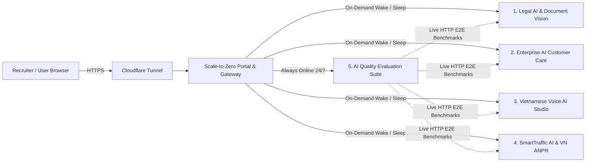

# Hi, I'm Phạm Thành Thái 👋

**Fresher Data Scientist · AI / ML Systems Engineer**  
Building end-to-end production AI pipelines across **NLP, RAG, Computer Vision, Speech AI (STT/TTS), and Automated AI Evaluation**.

**- Live Interactive Portfolio (5 Systems):** [https://thaipt.io.vn](https://thaipt.io.vn)  
**- Email:** phamthaibh2003@gmail.com

---

## Live AI Product Suite (`thaipt.io.vn`)

> All 5 systems run live behind a **Scale-to-Zero Orchestrator Portal** (`https://thaipt.io.vn`) for one-click interactive testing—including built-in sample documents, images, audio, and 1-click demo accounts so reviewers can test immediately without setup.

| # | System | Live Demo | Core Capabilities | Technologies |
|---|---|---|---|---|
| 1 | **Legal AI & Document Vision** | [audit.thaipt.io.vn](https://audit.thaipt.io.vn) | Administrative format & Vietnamese spell checking, legal retrieval & RAG Q&A, document deskewing, red-seal & handwritten signature inspection | `Python`, `FastAPI`, `OpenSearch (RAG)`, `OpenCV`, `VLM`, `Docker` |
| 2 | **Enterprise AI Customer Care** | [care.thaipt.io.vn](https://care.thaipt.io.vn) | Multi-channel Q&A with out-of-scope refusal, tool calling, voice-to-chat, Zalo OA webhook, live agent handoff, admin knowledge portal | `FastAPI`, `React`, `Qdrant`, `PostgreSQL`, `Redis`, `RabbitMQ`, `MinIO`, `Docker` |
| 3 | **Vietnamese Voice AI Studio** | [voice.thaipt.io.vn](https://voice.thaipt.io.vn) | Real-time WebSocket streaming ASR, batch transcription, Vietnamese call intent classification (`AGREE`/`DISAGREE`/`UNCERTAIN`), multi-voice TTS & Callbot simulator | `Python`, `FastAPI`, `WebSocket`, `Streaming STT/ASR`, `VAD`, `PhoBERT (ONNX)`, `TTS`, `Docker` |
| 4 | **SmartTraffic AI & VN ANPR** | [traffic.thaipt.io.vn](https://traffic.thaipt.io.vn) | Multi-vehicle CCTV tracking, In/Out line crossing, Polygon ROI no-parking violation alerts, 1-line/2-line Vietnamese license plate OCR with MP4/CSV export | `Python`, `FastAPI`, `YOLOv8 (ONNX)`, `Multi-Object Tracking`, `OCR`, `OpenCV`, `FFmpeg`, `Docker` |
| 5 | **AI Quality Evaluation Suite** | [eval.thaipt.io.vn](https://eval.thaipt.io.vn) | Live HTTP evaluation (RAG groundedness & refusal, ANPR recall, CV seal/signature check, TTS→ASR→Intent), P50/P95 latency & SQLite regression history | `Python`, `FastAPI`, `Async HTTP`, `SQLite`, `Docker` |

---

## High-Level Architecture

---

## Verified End-to-End Evaluation Results

Measured directly against live containerized microservices via `https://eval.thaipt.io.vn` and standalone E2E acceptance suites:

| Component | Eval Score | Cases | Latency (P50 / P95) | Status |
|---|---:|---:|---:|---|
| 1. Legal AI & Document Vision | **100.0%** | 3 / 3 | 2.35s / 3.39s | ✅ PASS |
| 2. Vietnamese Voice AI Studio | **100.0%** | 3 / 3 | 1.93s / 6.30s | ✅ PASS |
| 3. Enterprise AI Customer Care | **100.0%** | 3 / 3 | 1.13s / 1.41s | ✅ PASS |
| 4. SmartTraffic AI & VN ANPR | **100.0%** | 3 / 3 | 5.12s / 37.49s | ✅ PASS |
| 5. AI Quality Evaluation & Control Checks | **100.0%** | 12 / 12 | 0.1ms / 0.6ms | ✅ PASS |

---

## Quick Guide for Reviewers (`thaipt.io.vn`)

1. Open **[https://thaipt.io.vn](https://thaipt.io.vn)** and click **"Bật & Trải nghiệm"** on any sleeping AI system (~15–30s cold start; Scale-to-Zero automatically manages memory).
2. Try built-in samples right inside each app:
   - **Legal AI (`audit.thaipt.io.vn`):** Click *"Dán văn bản mẫu"* or *"Ảnh mẫu hợp lệ / Ảnh mẫu lỗi"* to test spell/format checks, legal Q&A, and CV seal/signature inspection.
   - **Customer Care (`care.thaipt.io.vn`):** Use **1-click Demo Login** (*Khách hàng 1*, *Khách hàng 2*, *Agent*, *Admin*) to test live account lookup, package management, and RAG Q&A.
   - **Voice AI (`voice.thaipt.io.vn`):** Test sample text/TTS, microphone streaming ASR, or interactive AI Call simulation.
   - **SmartTraffic (`traffic.thaipt.io.vn`):** Run sample highway/parking videos and 1-line/2-line Vietnamese plate images.
   - **Eval Suite (`eval.thaipt.io.vn`):** Enable **"Auto-Wake"** and run live end-to-end benchmarks across any subsystem.

---

*Note: Core source repositories for commercial and custom optimization pipelines are maintained as **Private**. Live demos are publicly accessible at [thaipt.io.vn](https://thaipt.io.vn); detailed code walkthroughs are available during technical interviews.*
